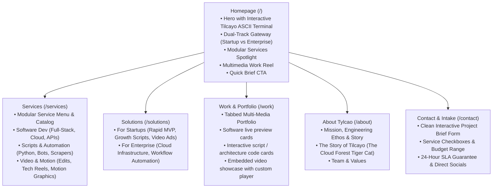

# Tylcao — Company Website Specification & Implementation Plan

> [!NOTE]
> **Tylcao** is a hybrid technology and creative production firm specializing in **Software Engineering**, **Scripts & Automation**, and **Video Editing & Motion Graphics**. 
> The brand identity marries high-performance deep-tech engineering with the enigmatic spirit of the newly discovered Andean wildcat: **Tilcayo** (*Leopardus tilcayo*), immortalized as an interactive ASCII mascot.

---

## 1. Executive Summary & Brand Foundation

| Element | Specification |
| :--- | :--- |
| **Company Name** | **Tylcao** |
| **Mascot & Icon** | **Tilcayo ASCII Cat** (*Leopardus tilcayo*) — interactive hero terminal mascot, brand mark & easter egg |
| **Core Pillars** | 1. Software Engineering & Cloud Solutions<br>2. Custom Scripts & Workflow Automation<br>3. Video Editing & Creative Media Production |
| **Target Audience** | **Dual-Track**: High-growth Startups (agile MVPs, rapid scripts, video creatives) & Enterprises (scalable architecture, robust automation) |
| **Visual Aesthetic** | **Modern Deep Tech**: Obsidian / slate dark mode (`#090a0f`), electric cyan (`#00f2fe`) and emerald (`#10b981`) ambient glows, precision grid lines, and monospace code accents |
| **Primary CTA** | Clean multi-service inquiry form with interactive service toggles, budget tiers, and brief attachment |
| **Tech Stack** | **Next.js 14+ (App Router)**, **TypeScript**, **Tailwind CSS**, **Framer Motion**, **Lucide Icons** |

---

## 2. Information Architecture & Page Map



---

## 3. Brand Identity & Visual Design Tokens

### Color Palette
- **Obsidian Dark Surface**: `bg-[#08090d]` / `bg-[#0f1118]`
- **Card / Surface Alt**: `bg-[#131620]` with border `border-slate-800/80`
- **Neon Cyan Accent**: `#00f0ff` (Primary actions, glow highlights, terminal prompt)
- **Emerald Accent**: `#10b981` (Success states, uptime, automation status)
- **Violet Secondary**: `#8b5cf6` (Creative media & video tags)
- **Text Hierarchy**: White `#f8fafc` (Headings), Slate-300 `#cbd5e1` (Body), Slate-500 `#64748b` (Meta/Muted)

### Mascot Design (Tilcayo ASCII Cat)
Sourced directly from `/home/aflouk/Downloads/cat.txt`:
```text
⠀⠀⠀⠀⠀⠀⠀⠀⠀⢠⣶⣦⡄⠀⠀⠀⠀⠀⠀⠀⠀⠀⠀⢀⣤⣤⡀⠀⠀⠀⠀⠀⠀⠀⠀⠀
⠀⠀⠀⠀⠀⠀⠀⠀⢠⣿⣿⣿⣿⡄⠀⠀⠀⠀⠀⠀⠀⠀⢀⣾⣿⣿⣿⡄⠀⠀⠀⠀⠀⠀⠀⠀
⠀⠀⠀⠀⠀⠀⠀⢠⣿⣿⣿⣿⣿⣷⡀⠀⠀⠀⠀⠀⠀⠠⣾⣿⣿⣿⣿⣿⡀⠀⠀⠀⠀⠀⠀⠀
⠀⠀⠀⠀⠀⠀⢀⣿⣿⣿⣿⣿⣿⣿⣧⠀⠀⠀⠀⠀⠀⢸⣿⣿⣿⣿⣿⣿⣧⠀⠀⠀⠀⠀⠀⠀
⠀⠀⠀⠀⠀⠀⣼⣿⣿⣿⣿⣿⣿⣿⣿⡇⠀⠀⠀⠀⢠⣿⣿⣿⣿⣿⣿⣿⣿⡆⠀⠀⠀⠀⠀⠀
⠀⠀⠀⠀⠀⢠⣿⣿⣿⣿⣿⣿⣿⣿⣿⣿⡀⠀⠀⠀⣸⣿⣿⣿⣿⣿⣿⣿⣿⣧⠀⠀⠀⠀⠀⠀
⠀⠀⠀⠀⠀⣼⣿⣿⣿⣿⣿⣿⣿⣿⣿⣿⣧⣤⣤⣴⣿⣿⣿⣿⣿⣿⣿⣿⣿⣿⠀⠀⠀⠀⠀⠀
⠀⠀⠀⠀⢀⣿⣿⣿⣿⣿⣿⣿⣿⣿⣿⣿⣿⣿⣿⣿⣿⣿⣿⣿⣿⣿⣿⣿⣿⣿⠀⠀⠀⠀⠀⠀
⠀⠀⠀⠀⢸⣿⣿⣿⣿⣿⣿⣿⡿⠿⣿⣿⣿⣿⣿⣿⣿⣿⣿⣿⣿⣿⣿⣿⣿⣿⠀⠀⠀⠀⠀⠀
⠀⠀⠀⠀⠈⣿⣿⣿⣿⣿⠋⠁⠀⠀⠈⠹⣿⣿⣿⣿⣿⡿⠋⠀⠀⠈⠻⣿⣿⣿⠀⠀⠀⠀⠀⠀
⠀⠀⠀⠀⠀⣿⣿⣿⣿⠃⠀⠀⠀⣴⣶⡄⢹⣿⣿⣿⣿⠃⢰⣶⡄⠀⠀⣿⣿⣿⠀⠀⠀⠀⠀⠀
⠀⠀⠀⠀⠀⣿⣿⣿⣿⡆⠀⠀⠀⠹⠿⠁⣸⣿⣿⣿⣿⡀⠘⡿⠃⠀⢀⣿⣿⣿⡆⠀⠀⠀⠀⠀
⠀⠀⠀⠀⠀⣿⣿⣿⣿⣿⣿⣿⣿⣿⣿⣶⣿⣿⣯⣹⣿⣷⣤⣾⣿⣿⣿⣿⣿⣿⣃⣀⣀⣀⣀⠀
⠀⠾⠿⠟⠛⠻⣿⣿⣿⣿⣿⣿⣿⣿⣿⣿⣿⣿⣿⣿⣿⣿⣿⣿⣿⣿⣿⣿⣿⡿⠛⠋⠉⠉⠋⠀
⠠⣤⣤⣶⡶⠿⠛⣿⣿⣿⣿⣿⣿⣿⣿⣿⣿⣿⣿⣿⣿⣿⣿⣿⣿⣿⣿⣿⡿⠛⠛⠛⠛⠷⣶⡄
⠀⠀⠉⢀⣠⣶⠾⠟⠉⠻⢿⣿⣿⣿⣿⣿⣿⣿⣿⣿⣿⣿⣿⣿⣿⣿⠟⠛⠛⠳⢶⣦⣄⡀⠀⠀
⠀⠀⠀⠟⠋⠁⠀⠀⠀⠀⠀⣼⣿⣿⣿⣿⣿⣿⣿⣿⣿⣿⣿⡏⠁⠀⠀⠀⠀⠀⠀⠀⠉⠁⠀⠀
⠀⠀⠀⠀⠀⠀⠀⠀⠀⠀⢰⣿⣿⣿⣿⣿⣿⣿⣿⣿⣿⣿⣿⡇⠀⠀⠀⠀⠀⠀⠀⠀⠀⠀⠀⠀
⠀⠀⠀⠀⠀⠀⠀⠀⠀⢠⣿⣿⣿⣿⣿⣿⣿⣿⣿⣿⣿⣿⣿⣇⠀⠀⠀⠀⠀⠀⠀⠀⠀⠀⠀⠀
⠀⠀⠀⠀⠀⠀⠀⠀⢀⣿⣿⣿⣿⣿⣿⣿⣿⣿⣿⣿⣿⣿⣿⣿⠀⠀⠀⠀⠀⠀⠀⠀⠀⠀⠀⠀
⠀⠀⠀⠀⠀⠀⠀⢀⣾⣿⣿⣿⣿⣿⣿⣿⣿⣿⣿⣿⣿⣿⣿⣿⡇⠀⠀⠀⠀⠀⠀⠀⠀⠀⠀⠀
⠀⠀⠀⠀⠀⠀⢀⣾⣿⣿⣿⣿⣿⣿⣿⣿⣿⣿⣿⣿⣿⣿⣿⣿⣿⡀⠀⠀⠀⠀⠀⠀⠀⠀⠀⠀
⠀⠀⠀⠀⠀⢀⣾⣿⣿⣿⣿⣿⣿⣿⣿⣿⣿⣿⣿⣿⣿⣿⣿⣿⣿⣇⠀⠀⠀⠀⠀⠀⠀⠀⠀⠀
⠀⠀⠀⠀⠀⣼⣿⣿⣿⣿⣿⣿⣿⣿⣿⣿⣿⣿⣿⣿⣿⣿⣿⣿⣿⣿⡄⠀⠀⠀⠀⠀⠀⠀⠀⠀
⠀⠀⠀⠀⣸⣿⣿⣿⣿⣿⣿⣿⣿⣿⣿⣿⣿⣿⣿⣿⣿⣿⣿⣿⣿⣿⡇⠀⠀⠀⠀⠀⠀⠀⠀⠀
```
This artwork will be:
- Featured in the interactive hero terminal (`TilcayoHeroTerminal`) with neon cyan/emerald matrix glows and typing effects.
- Converted into a high-precision SVG icon/logo mark for the navbar header, browser favicon, and footer brandmark.

---

## 4. Key Interactive Components

1. **Tilcayo ASCII Hero Terminal**:
   - Live typewriter effect rendering the Tilcayo ASCII cat.
   - Interactive command prompt with preset quick-action buttons.
   - Live status indicator: `● SYSTEMS OPERATIONAL | ACCEPTING NEW PROJECTS`.

2. **Modular Service Menu & Interactive Catalog**:
   - Filterable cards across:
     - **Software Engineering**: Web Apps, Mobile, APIs, Cloud Infra, Microservices.
     - **Scripts & Automation**: Python scrapers, custom Telegram/Discord bots, Zapier/n8n custom nodes, ETL pipelines, cron automation.
     - **Video Editing**: Product demo reels, YouTube/TikTok high-retention cuts, 3D motion graphics, automated video rendering.
   - "Add to Project Brief" button that pre-populates the contact form.

3. **Tabbed Multimedia Portfolio**:
   - **Software Tab**: Live device frame cards with tech badges and GitHub/live demo links.
   - **Scripts & Automation Tab**: Expandable terminal/code inspection cards displaying script specs, runtime, and architecture diagrams.
   - **Video Editing Tab**: Video player cards with high-framerate playback previews, timeline scrubs, and sound toggles.

4. **Streamlined Project Intake Form**:
   - Multi-select service checklist (Software, Scripts, Video).
   - Dynamic budget range selector (`<$2.5k`, `$2.5k-$10k`, `$10k-$25k`, `$25k+`).
   - Project description input with file drag-and-drop support.
   - Instant confirmation with ticket/reference ID simulation.

---

## 5. Phased Implementation Roadmap

- [ ] **Phase 1: Project Initialization & Theme Setup**
  - Initialize Next.js project with TypeScript and Tailwind CSS in `/home/aflouk/tylcao-website`.
  - Configure custom color tokens, fonts (Inter + JetBrains Mono), and Lucide icons.
  - Build common layout: Cyber/Deep-tech Navbar with Tilcayo brand mark, and comprehensive Footer.

- [ ] **Phase 2: Mascot & Core Components**
  - Implement the `TilcayoAsciiTerminal` component with reactive easter eggs.
  - Implement the `AudienceSwitch` (Startup vs Enterprise preview cards).
  - Implement the `ModularServiceCatalog` with filtering and tag selection.

- [ ] **Phase 3: Page Route Development**
  - Build **Homepage (`/`)**: Hero terminal, service highlights, portfolio preview, testimonial proof, CTA.
  - Build **Services (`/services`)**: Full modular catalog with deep breakdowns for Software, Scripts, and Video.
  - Build **Solutions (`/solutions`)**: Tailored value propositions for Startups and Enterprises.
  - Build **Work (`/work`)**: Tabbed portfolio with video previews and code cards.
  - Build **About (`/about`)**: Company origin, Tilcayo cat folklore, engineering philosophy.
  - Build **Contact (`/contact`)**: Clean, interactive project brief builder and inquiry form.

- [ ] **Phase 4: Polish, Responsiveness & Verification**
  - Test all viewport sizes (mobile, tablet, desktop).
  - Verify smooth animations and terminal commands.
  - Run production build and lighthouse check.
